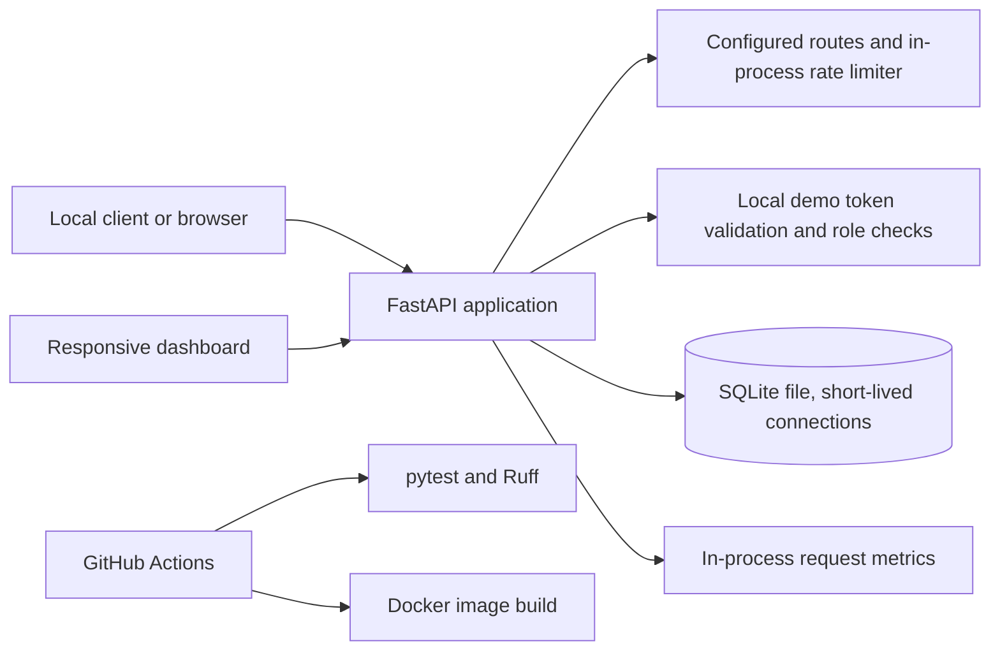
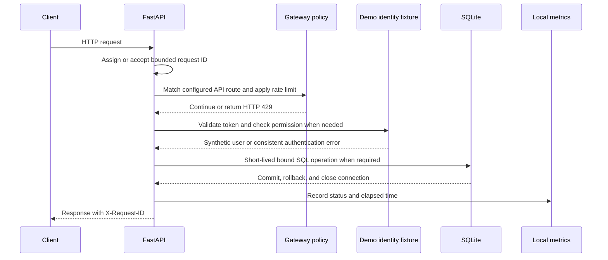

# Architecture

## Component diagram

## Request flow

## Components and constraints

- **API:** `services/platform_api.py` creates the local FastAPI app. The root health endpoint
  reports API and SQLite status; `/dashboard` serves the static responsive demonstration.
- **Authentication and authorization:** `services/auth_service/` recognizes only documented
  synthetic local tokens. `has_permission` enforces distinct viewer, operator, and admin
  permissions. This is not an identity provider, and there is no real login or token issuance.
- **Gateway:** `services/api_gateway/` describes the local route table and applies an in-memory
  sliding-window limit to API requests. Per-process state is not a production/distributed gateway.
- **Database:** `shared/database.py` creates a SQLite fixture and uses per-operation connections,
  a busy timeout, transactions, and explicit closure. SQLite behavior does not establish how a
  PostgreSQL connection pool would behave.
- **Monitoring:** `services/monitoring_service/metrics.py` records process-local request totals,
  errors, average latency, and route counts. These are measurements from this process, not
  fabricated cloud metrics, and reset on restart.
- **CI:** `.github/workflows/ci.yml` runs Ruff and pytest and builds a Docker image on pushes and
  pull requests. The file's presence is not evidence that a GitHub Actions run occurred.
- **Infrastructure:** Kubernetes files are illustrative local manifests. Terraform is a
  provider-free metadata scaffold that creates no resources.

## Jira and GitHub evidence

The nine ECP titles are listed as static fixtures at `/api/v1/demo/issues`. They are not live Jira
records. Only Jira can establish assignment/status; only GitHub can establish branch, pull
request, review, merge, or Actions-run state. A Jira key in code or documentation is not proof of
a linked or completed external work item.
